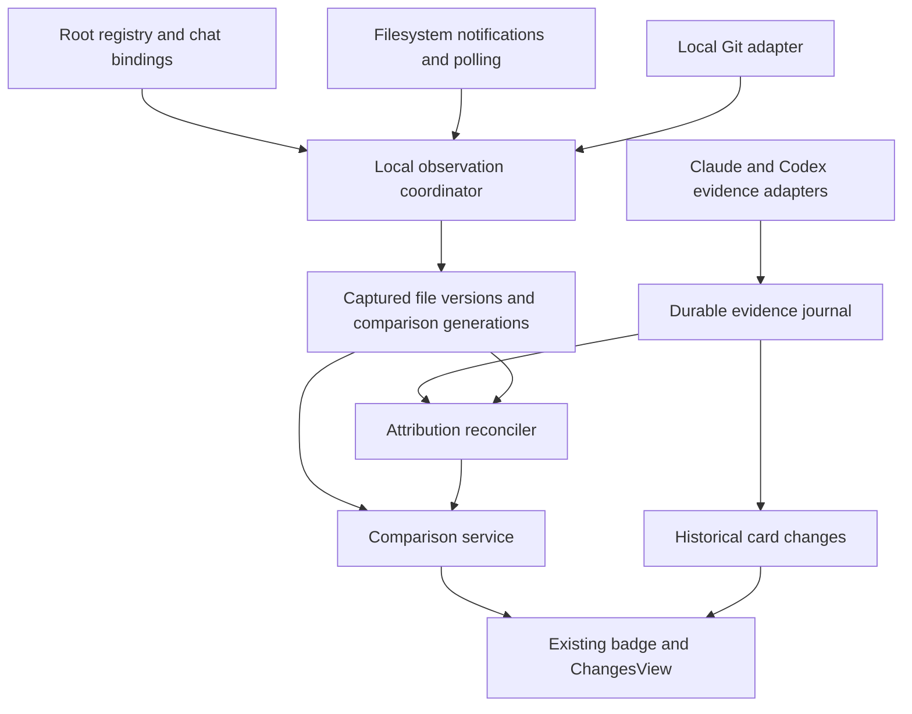

# Threadlight local change tracking specification

Date: 29 October 2026. Status: Reviewed and amended; initial implementation built
and locally validated. Full release acceptance remains open as recorded in
`../validation/LOCAL-CHANGE-TRACKING-VALIDATION.md`.

Threadlight should measure local file changes independently of Claude and Codex,
support projects with and without Git, and associate changes with chats only to
the extent supported by recorded evidence. Different worktrees must remain
separate even when their repository, project, branch name or filenames overlap.

This specification defines the replacement for the current thread attribution
algorithm and the common data service behind card, thread and folder diffs. The
user authorised updating and implementing the reviewed design on 29 October 2026.
Section 24 records the review amendments. The implementation record distinguishes
working functionality from outstanding acceptance work; design approval is not a
claim that every scenario below has passed. Git mutations and remote account
connections are outside this feature.

## 1 Product decision and review brief

Build a local change service inside Threadlight. Use local Git when a checkout is
available and a Threadlight snapshot baseline for ordinary folders. Keep provider
patches as historical evidence. GitHub or GitLab sign-in is an independent future
feature for remote collaboration; it is not a dependency of local change tracking.

The service must answer three different questions clearly:

| View                       | Question                                                                 | Evidence                                              |
| -------------------------- | ------------------------------------------------------------------------ | ----------------------------------------------------- |
| Card changes               | What did this recorded edit operation change?                            | Immutable provider patch or successful tool result    |
| Worktree or folder changes | What differs between the selected local endpoints?                       | Local Git or captured folder versions                 |
| Thread changes             | Which differences between those endpoints are attributable to this chat? | Provider evidence reconciled with local file versions |

These views need consistent scope and presentation, not artificially identical
totals. Repeated edits, reversals, commits, formatting and the selected comparison
can legitimately produce different totals.

Astra should review the architecture, identify unsupported guarantees and resolve
the decisions in section 23. In particular, review the comparison semantics,
limits of attribution, source retention defaults, provider capabilities and
migration from the current staged-change behaviour. A complete-looking thread
total must never be manufactured to match the folder total.

## 2 Verified failure and current implementation

### 2.1 Reproduced discrepancy

The reported screenshot showed three completed edit cards totalling +80 / -25
across four distinct files. Its thread badge showed +37 / -21. Replaying those
operations, the intervening Prettier run and the subsequent patch in an isolated
repository reproduced that exact badge.

| File role               | Historical card totals | Existing thread attribution | Current files versus baseline commit in the replay |
| ----------------------- | ---------------------- | --------------------------- | -------------------------------------------------- |
| Communication component | +19 / -11              | +19 / -11                   | +19 / -11                                          |
| Shared Spaces CSS       | +26 / -3               | +3 / -3                     | +28 / -3                                           |
| Shared Spaces component | +24 / -5               | +4 / -1                     | +60 / -39                                          |
| Communication UI test   | +11 / -6               | +11 / -6                    | +11 / -6                                           |
| Total                   | +80 / -25              | +37 / -21                   | +118 / -59                                         |

The recorded cards are accurate for their operations. The folder comparison also
includes formatter changes, so +118 / -59 is not an expected replacement thread
total. The defect is loss of attribution after lines move or change shape,
combined with an insufficiently visible incomplete result.

The replay used baseline commit `90d6aa9`, the first three native `fileChange`
items of the workflow-tab change, formatting after the first two operations, and
then the third operation. The historical worktree was later committed. Its current
clean state must not be used to contradict the earlier screenshot.

### 2.2 Existing code to reuse

Paths in this document are relative to the Threadlight repository root.

| Component                                | Current role                                                               | Proposed treatment                                                                   |
| ---------------------------------------- | -------------------------------------------------------------------------- | ------------------------------------------------------------------------------------ |
| `src/main/sessions/gitRepository.ts`     | Resolves actual root, Git directory and common Git directory               | Extend as the basis of checkout identity                                             |
| `src/main/sessions/gitStates.ts`         | Demand-driven caches, watchers and metadata publication                    | Reuse scheduling; converge on shared generations                                     |
| `src/main/sessions/gitProcess.ts`        | Bounded Git subprocess queue                                               | Retain one shared budget                                                             |
| `src/main/sessions/gitDiff.ts`           | Repository metadata and aggregate counts                                   | Derive counts from the common comparison service                                     |
| `src/main/sessions/gitChanges.ts`        | Direct worktree file lists and patches                                     | Retain Git semantics; remove independent count discrepancies                         |
| `src/main/sessions/threadDiffSources.ts` | Claude and Codex recorded edit adapters                                    | Retain evidence, add capabilities and durable cursors                                |
| `src/main/sessions/threadDiff.ts`        | Historical edit ledger and net recorded changes                            | Reuse validated patch handling where sound; replace positional ownership assumptions |
| `src/main/sessions/threadUncommitted.ts` | Matches recorded text and original line coordinates to current Git patches | Replace as the authority for current thread attribution                              |
| `src/main/sessions/threadChanges.ts`     | Thread summary, viewer and snapshot cache                                  | Adapt to the new scope and coverage model                                            |
| `src/main/codex/threadFileChanges.ts`    | Projects native per-operation card patches and counts                      | Preserve historical semantics                                                        |
| `src/shared/cardChanges.ts`              | Renders recorded card patches                                              | Preserve isolation from current-file comparisons                                     |
| `src/renderer/panel/ChangesView.tsx`     | Shared card, thread and worktree viewer                                    | Extend rather than build another viewer                                              |
| `src/shared/types.ts`                    | Existing Git, diff and session contracts                                   | Add explicit comparison and coverage contracts                                       |

`docs/specs/THREAD-DIFF-SPEC.md` currently permits omitted attribution for moved
lines and preserves staged-only changes in its thread projection. This proposal
changes both the accuracy contract and comparison presentation. That document
remains the implemented behaviour until the replacement is approved and shipped.
Do not silently rewrite it as if this proposal were already implemented.

### 2.3 Current limitations relevant to this design

The thread service currently requires a Git root, so it cannot provide ordinary
folder tracking. Worktree metadata and viewer reads have separate paths and
different limits for counting untracked files. Current thread summaries expose a
single `complete` boolean, which cannot distinguish missing history, ambiguous
attribution, capture gaps and unavailable content. A zero-file result often has
no visible badge, even when that result is incomplete.

These are separate problems; replacing exact line-number matching alone does not
solve them.

## 3 Goals and boundaries

### 3.1 Required outcomes

1. Claude and Codex can contribute changes to one common local model.
2. Each actual checkout has an independent file inventory, Git state and revision.
3. Ordinary local folders can show changes since a declared snapshot baseline.
4. Header, file list and opened patch refer to the same comparison revision.
5. Historical cards retain their original patches after formatting or commits.
6. Line movement alone does not erase attribution when a unique, continuous
   content mapping proves that the same edit remains.
7. Unknown changes remain visible at folder scope and are disclosed at thread
   scope. Incomplete attribution cannot look like a complete small change.
8. Crashes, restarts, disconnections and storage limits preserve honest coverage.
9. Tracking stays local and performs no source-control mutations.

### 3.2 Outside this implementation

Remote account authentication, PR creation, fetching, pushing, merging, commits,
staging controls, restore/undo, automatic worktree creation and conflict resolution
are separate features. No feature here inserts hooks into repositories, wraps
arbitrary shells, intercepts operating-system writes or changes provider execution
permissions. A future instrumented writer may improve evidence through a separate
capability contract.

The service observes files available to the Threadlight host. It must not claim
to observe a remote machine, container-only path or cloud checkout merely because
a transcript mentions it.

## 4 Definitions and invariants

| Term          | Definition                                                              |
| ------------- | ----------------------------------------------------------------------- |
| Project       | A user-facing grouping; not a filesystem identity or diff baseline      |
| Repository    | A Git object/history identity shared by its worktrees                   |
| Checkout      | One actual local working directory with its own Git administration      |
| Folder scope  | An explicitly tracked non-Git root                                      |
| Root          | A checkout or folder scope approved for local inspection                |
| Binding       | Association of a provider-qualified chat with one root over an interval |
| Baseline      | An immutable before endpoint of a comparison                            |
| Epoch         | A period over which root identity and baseline semantics are stable     |
| Observation   | A captured file or Git state, without an assumed author                 |
| Edit evidence | A provider-recorded successful mutation linked to one chat              |
| Generation    | A published, internally consistent local observation revision           |
| Attribution   | Evidence-backed association of a comparison change with a chat          |
| Coverage      | What the service was able to inspect and reconstruct                    |

Mandatory invariants:

- Root identity is never a project name, branch name, remote URL or basename.
- Every result carries its root, comparison, generation and baseline identity.
- Filesystem events and timestamps invalidate observations; they do not prove an
  author, operation order across providers or a complete write history.
- A recorded provider patch proves what that provider reported, not exclusive
  causality for a later identical edit made by someone else.
- Current folder content, provider patch history and thread attribution remain
  separate records with separate availability states.
- A failed read never becomes an empty successful diff.
- Missing counts are `null`, not zero. Known counts in a partial result are
  labelled as a known subset, not an estimated full total.
- Counts sum changes in the selected comparison, not the number of operations.
- No read request can select an arbitrary root or file by supplying a path.

## 5 Comparison semantics

### 5.1 Git comparisons

Use explicit lenses. The proposed default preserves the existing worktree view's
HEAD-to-current-files meaning, while making staged and unstaged changes accessible
as separate comparisons.

| Lens              | Before                                          | After                          | User label                                          |
| ----------------- | ----------------------------------------------- | ------------------------------ | --------------------------------------------------- |
| `git-current`     | Captured HEAD tree                              | Captured working files         | Current files vs last commit                        |
| `git-staged`      | Captured HEAD tree                              | Captured index                 | Staged changes                                      |
| `git-unstaged`    | Captured index                                  | Captured working files         | Unstaged changes                                    |
| `folder-baseline` | Saved folder baseline                           | Captured working files         | Changes since tracking started, or named checkpoint |
| `card-event`      | Recorded operation before state where available | Recorded operation after state | This recorded edit                                  |

Untracked, non-ignored files appear as added files in `git-current`. In the
unstaged lens they appear in an explicit Untracked group; they are never described
as staged. A file absent from the selected before and after endpoints contributes
no lines to that comparison.

Do not add staged and unstaged line totals to obtain a default total. Example:
HEAD contains A, the index contains B, and the working file contains A. Current
files versus HEAD has no net text difference, but the staged and unstaged lenses
both have changes. The UI says **No net changes in current files; staged and
unstaged changes exist**, and provides the corresponding lens controls.

The thread view uses the same selected lens as its containing comparison. It
must not retain staged-only lines in a headline labelled current files. Selecting
Staged changes shows the attributable staged lines. This intentionally replaces
the existing union of HEAD-to-working and HEAD-to-index thread patches.

### 5.2 Commits and branch changes

A new commit moves the current comparison's HEAD endpoint. Fully committed edits
leave the default pending view; cards and local observations retain their history.
Partial commits retain only the remaining differences under the same lens.

A branch switch, reset, rebase, checkout replacement or changed Git-directory
identity creates a reconciliation boundary. Invalidate all cached comparisons,
capture new endpoints and begin a new attribution epoch where necessary. Do not
attribute the resulting bulk file changes to whichever chat was most recently
active. Historical bindings remain inspectable; current bindings require fresh
evidence if the same chat continues on the new state.

### 5.3 Non-Git comparisons

The before endpoint is a captured, named baseline. Its timestamp is visible.
Changes already present when tracking began belong to that baseline; they cannot
be reconstructed as earlier folder changes without additional historical evidence.

Git-style staged/unstaged controls do not appear. **Start a new baseline** makes
a new epoch and keeps the previous one available according to retention policy.
It changes Threadlight's comparison only and does not modify project files.

If a folder becomes a repository, preserve its snapshot history and create an
explicit Git epoch. If Git becomes unavailable, retain the last Git result as
stale. An available folder comparison is labelled separately; never silently
reinterpret a Git badge as a snapshot badge.

## 6 Root identity and chat binding

### 6.1 Git identity

Persist opaque IDs for repository and checkout. Resolve canonical root, per-checkout
Git directory and common Git directory. The common directory groups related
worktrees; the root plus per-checkout Git directory separates their file state.

Canonicalisation must handle Windows case rules, normal and extended drive paths,
UNC paths, junctions and symbolic links. Resolve aliases before cache lookup.
Case-sensitive filesystem behaviour must not be flattened globally. A missing
or offline root retains its last known identity and becomes unavailable; it is
not recreated as a different folder just because `realpath` failed.

Detect nested repositories before adopting an ancestor. Submodules are separate
roots for detailed source changes; a parent's gitlink change is a metadata change.
Do not recursively count the submodule contents in the parent total.

A moved worktree can retain its identity only after verifying its Git-directory
association. A deleted worktree and a new checkout at the same path must not share
the previous attribution ledger automatically. For plain folders without durable
filesystem identity, ambiguous replacement creates a new root epoch.

### 6.2 Bindings

Represent a binding as `(provider, nativeChatId, rootId, bindingEpoch)` with source,
effective sequence range and state. Provider prefixes are required even when
native IDs happen to be unique. One chat may have several bindings if it edits
several roots; several chats may bind to one root.

Binding evidence is ordered by authority:

1. Explicit user selection of an authorised local root.
2. A provider's structured attached-worktree or execution-root metadata.
3. Successful structured file-change evidence resolved to an already authorised
   root, with the absolute path verified locally.
4. A session working directory as a discovery candidate.

Prose, shell-command strings, titles and repository names are hints only. The
current Codex chat may have a generated chat directory as its working directory
while editing a checkout elsewhere; do not assume `session.cwd` is the code root.

Metadata may discover a candidate outside the currently authorised root, but may
not authorise recursive capture there. Present **Another folder detected** with
the exact path and use the existing root-selection/access flow. Do not scan an
entire user profile to find the project.

Changes from multiple roots appear in separate groups. The compact chat badge
may aggregate known counts only when it also identifies the multi-root scope and
the common lens. Detailed views always retain each root and baseline. Never use
the first available root as a substitute for the others.

## 7 Service architecture

Use one main-process orchestration service with workers for expensive reads and
diffing. Components can be separate modules, but they must share identity,
generation and coverage contracts.



| Component               | Responsibility                                                                  |
| ----------------------- | ------------------------------------------------------------------------------- |
| Root registry           | Canonical identity, access scope, checkout lifecycle and bindings               |
| Provider adapters       | Successful edit evidence, capabilities, cursors and source gaps                 |
| Observation coordinator | Watch invalidation, inventory, capture and generation publication               |
| Git adapter             | Local endpoint discovery, status, comparisons and Git availability              |
| Snapshot store          | Baselines, captured versions, durable event metadata and bounded retention      |
| Diff engine             | Deterministic text comparisons and count generation                             |
| Attribution reconciler  | Maps provider evidence to captured versions and selected comparison             |
| Comparison service      | One result contract for totals, file lists, patches and coverage                |
| Diagnostics             | Reasons for missing evidence, latency and limits without source-content logging |

No renderer reads provider databases or source files directly. No remote login is
required. Keep a single shared limit for Git processes and a separate bounded
worker budget for file capture and text diffing.

## 8 Observation and baseline capture

### 8.1 Capture mode

Introduce a per-root **Record local file history** setting. Existing users retain
their current Git/provider functionality until they enable content recording.
For a newly selected ordinary folder, the tracking setup explains that local file
versions are retained and enables recording through that explicit selection.
Persisting source content must not be silently enabled for every historically
discovered chat or drive.

With recording off, direct Git comparisons and available provider cards still
work. Thread attribution uses available historical evidence and exposes its
limitations. The product must not require recording solely to view Git diffs.

Recording off also means no new source bytes or patches are persisted in the
snapshot store. Bounded in-memory patches may serve an open Git comparison and
expire with that view. Persisted metadata may identify hashes, coverage and
provider source references without copying their source content. Historical cards
can still be read from the provider's existing authorised history. Turning
recording off stops new capture; forgetting already retained history is a separate
explicit setting.

### 8.2 Initial inventory

1. Establish the root identity, include/exclude policy and capture epoch.
2. Start notification collection before enumeration to reduce the observation gap.
3. Enumerate authorised files within the limits in section 17.
4. Capture each eligible file with before/after metadata checks and content hash.
5. Revisit files invalidated during enumeration.
6. Publish an initial baseline only after the bounded consistency pass succeeds.

A directory tree is not atomically snapshotted by ordinary filesystem reads.
If it keeps changing, publish **Baseline still being captured** or a partial
baseline with explicit files/gaps. Do not claim that all files existed in one
instant unless the backend actually provides such a snapshot.

Baseline creation has an ID and per-file version references. It must distinguish
files present, confirmed absent, excluded, unreadable and not yet enumerated.
An existing file with an unknown baseline is **Before state unavailable**, not a
new file with all lines added.

### 8.3 Ongoing observations

Notifications mark paths dirty; debouncing schedules reads. Capture eligible file
bytes, classify text/binary, hash them and record a version only when the bytes or
relevant metadata changed. Atomic-save rename patterns are reconciled as file
versions rather than assumed permanent deletion followed by an unrelated create.

Use a durable monotonic journal sequence for ingestion. Preserve provider-native
ordering independently. Arrival order across two providers is not a causal order.
Where observations were coalesced, record a possible gap instead of inventing
intermediate contents.

On watcher error, overflow, resume from sleep, root reconnect or startup, perform
a bounded inventory reconciliation. Polling covers missed notifications. File
mtime and size are optimisation hints, not proof of unchanged content after a
known invalidation. A stable same-size edit must still be detected by hashing.

### 8.4 Rapid writes and concurrent reads

For each file read, compare file identity/size/mtime before and after reading;
retry at most twice when unstable. Hash the actual captured bytes. Revalidate the
path and root after opening where supported. If stability cannot be established,
retain the previous observation as stale and report `concurrent-write`.

Even successful metadata checks do not guarantee capture of every intermediate
write. Claims of continuous attribution require provider-linked versions or other
positive evidence; a quiet watcher is insufficient.

## 9 Provider evidence adapters

### 9.1 Common evidence record

Each mutation has a logical key `(provider, chatId, sourceEpoch, nativeItemId)`
and separately identified immutable revisions. Exactly one valid completed revision
is effective per logical key. Repeated ingestion is idempotent; an older or malformed
revision never replaces a valid newer one. Adapters must supply native revision
ordering, or explicitly report an unordered conflicting revision. Cursor advancement
and effective-revision replacement commit together. A correction invalidates dependent
projections, not previously published immutable comparisons.

Record root binding, paths before/after, operation type, native order, capture
time, patch, available full before/after content or hashes, success state and
evidence limitations. Keep source timestamps for diagnostics, not exclusive
ordering. A malformed later event must not corrupt an earlier valid edit.

### 9.2 Codex

Accept completed native `fileChange` items. Preserve add/update/delete/move
metadata, complete patch data where available and per-card counts. Failed or
in-progress items do not establish applied mutations. A command execution item
may indicate that reconciliation is needed; its command text does not prove which
files it changed.

Use the supported local provider surfaces already consumed by Threadlight. Detect
schema or capability changes; fail the adapter explicitly instead of parsing
prose as a substitute. Bound history reads and expose source truncation.

### 9.3 Claude

Pair Edit, MultiEdit, Write and supported notebook operations with successful
results by tool-call ID and transcript epoch. Use full original content and
structured patches when provided. Unknown notebook formats remain metadata-only
until an appropriate adapter exists. Do not manufacture line diffs for an opaque
notebook or unknown tool result.

Replay incrementally, tolerate partial UTF-8/JSON tails and restart safely on
transcript replacement or truncation. Sidechain/subagent changes remain associated
with their actual actor. Parent views may offer an explicit includes-subagents
filter later; they must not silently double-count child edits.

### 9.4 Capability declaration

Expose whether an adapter supports historical patches, full preimages, postimages,
native ordering, live edit lifecycle, correlated command boundaries and reliable
root metadata. Missing capability lowers coverage, not the quality threshold for
an exact claim. The same product truth rules apply to both providers even where
their available evidence differs.

## 10 Attribution model

### 10.1 Separate authorship evidence from completeness

Use two independent dimensions:

| Dimension   | States                                           | Meaning                                                        |
| ----------- | ------------------------------------------------ | -------------------------------------------------------------- |
| Association | `recorded`, `supported`, `unattributed`, `mixed` | How a change is connected to one or more chats                 |
| Coverage    | `complete`, `partial`, `unavailable`             | Whether the relevant inputs and mapping are sufficiently known |

`recorded` means a successful provider event identifies the chat and its operation.
`supported` means a deterministic, unique content mapping connects recorded evidence
to the current comparison, with stated continuity limits. `unattributed` has no
sufficient link. `mixed` has interacting evidence from several actors or unknown
transformations that cannot be separated safely.

Do not present numerical confidence percentages. These categories describe
evidence, not statistically calibrated probabilities. The UI can say **Recorded
edit**, **Matched through later edits**, **Author unknown** and **Mixed changes**.

### 10.2 Version mapping

Maintain per-file captured versions and recorded mutation edges. An edge references
available before/after hashes, validated patches, source identity and coverage.
The graph can contain gaps and competing branches; do not force every event into
one fabricated linear history.

For each mutation:

1. Resolve its root binding and historical path identity.
2. Validate the patch against a known preimage when available. A partial hunk can
   establish local evidence without pretending the whole file is known.
3. Derive the postimage or local changed spans and associate them with the event.
4. Match to captured versions by content and validated context, not ingestion time.
5. Map surviving spans through subsequent uniquely aligned versions.
6. Project the resulting associations onto the selected comparison endpoints.

Text identical at two locations, duplicate blocks and reordered repeated lines
can have several valid mappings. Preserve that ambiguity. A stable diff algorithm
choosing one alignment is not itself proof of which copy a chat edited.

### 10.3 Line movement

Line coordinates are positions within a version, not persistent ownership IDs.
Map unchanged lines/spans through verified insertions, deletions and unique moves.
Recompute their coordinates for the selected before and after endpoints.

An insertion above an owned change must not remove attribution. A unique block
move can retain association if the intermediate versions and mapping support it.
Ambiguous moves remain partial. Never solve this by dropping line numbers and
matching common text globally.

### 10.4 Replacements, deletions and reversals

Associate a replacement's removal and addition through its mutation edge. If
another actor overwrites the added side, do not leave the original removal owned
by the first chat merely because it appears in the current Git diff.

A reversal restores the selected baseline and contributes zero net lines in that
lens, while both operation cards remain. Deleting a file created in the same
comparison similarly produces zero net file changes if both endpoints are absent.
Two chats that make and reverse a change retain their distinct histories.

Partial commits and baseline changes must project associations onto the new before
endpoint. Do not assume the first provider preimage is still HEAD. When a mapping
cannot be carried across the boundary, mark its affected coverage explicitly.

### 10.5 Formatters and shell writes

A formatter often produces changes outside native edit cards. Observe its actual
output in the folder comparison. Preserve already supported associations through
unchanged unique spans. Formatting that rewrites an owned span is a transformation
requiring additional evidence; it is not automatically owned by the same chat.

A shell command's recorded lifecycle can correlate an observation window with a
chat, but ordinary watchers cannot prove exclusive writes in that window. Such
correlation may appear as **Related observed changes** with partial coverage. It
cannot promote the entire file or folder to recorded ownership, even if only one
chat appears active. Manual editor writes and background tools may still exist.

If a future writer integration can provide a verifiable operation ID plus actual
before/after capture for its writes, ingest that as a stronger capability. This
release does not promise operating-system-level write attribution.

### 10.6 Multiple writers

Different worktrees are separate graphs. Different chats in the same checkout
share observed file versions but have separate evidence edges. Disjoint supported
edits may be separated; overlapping or overwritten changes may be mixed.

Known subsets for several chats need not sum to the worktree total. Some changes
can be unattributed, and overlapping associations are not a disjoint ownership
partition. Cross-chat combined views deduplicate by comparison change identity
and show mixed associations once. They must not add per-chat badges blindly.

### 10.7 Complete results

An exact folder comparison is possible when its selected endpoints and inventory
are complete within the declared include/exclude scope. Exact text differences
do not imply exact authorship.

A thread result is complete only for its declared evidence scope: all required
provider records are available, relevant path/version mappings have no unresolved
gap, and every included association meets the mapping rules. It must not claim
exclusive physical authorship merely because a patch matched. If relevant writes
could not be reconciled, expose partial coverage even when some counts are known.

## 11 Text, binary and metadata semantics

Use one deterministic text diff/count engine for captured content comparisons.
Pin its version and algorithm settings in the comparison identity. Git-backed
comparisons use Git-selected endpoints and must account for Git attributes and
canonicalisation; raw byte diffs and Git-normalised diffs cannot be interchanged
without a declared normalisation policy.

The first implementation should use Git-generated patches for supported Git text
comparisons and the common renderer/count parser, with a tested local text engine
for snapshot comparisons and version mapping. Before treating captured bytes as
a Git blob, handle line endings, encoding and applicable attributes explicitly.
Unsupported conversion produces an explicit limitation, not a forged match.

Rules:

- Define a line as a logical text line; trailing final newline is metadata and
  must not produce a fake empty added line.
- CRLF/LF and final-newline-only changes remain detectable. Display their policy
  and metadata even where a normalised text count is zero.
- Store raw content hashes separately from any comparison-normalised hash.
- Whitespace is significant by default; ignore-whitespace is an explicit lens
  option that changes the comparison identity and counts.
- Binary changes show changed-file status, size/hash metadata where captured,
  and unavailable text counts. They do not look like zero-line text changes.
- Unsupported encoding shows **Text encoding unsupported**, with metadata only.
- Renames retain before/after paths where proven. An ambiguous rename is a
  deletion and addition with an explanatory state, not guessed ownership.
- Permission/mode, symlink-target and submodule-pointer changes are metadata
  changes. Their file presence can be nonzero while text counts are zero.
- Symlinks are observed as links by default. Do not follow them outside the
  authorised root or recursively follow junction loops.
- Git conflicts show unmerged status and available stages; do not present one
  selected conflict file as a complete staged comparison.

Per-card counts continue to follow the provider's recorded patch. A truncated
preview must not reduce a known full-operation count. Truncation and missing
counts remain visible and are covered by separate flags.

## 12 Git adapter and local consistency

Read the local checkout directly. Use structured argument arrays, NUL-delimited
path output and a bounded shared queue. Commands must be read-only, hidden on
Windows and independent of provider sign-in. No fetch or network operation is
part of refresh.

Proposed primitives include repository discovery, worktree enumeration,
`status --porcelain=v2 -z`, HEAD/index endpoint capture and explicitly selected
diffs. Disable external diff and textconv commands for display reads. Review
attribute/filter and fsmonitor behaviour in the implementation so a claim about
external process execution is not broader than the actual Git invocation.
Do not automatically change `safe.directory`, repository configuration or ignore
files to make a read succeed.

An unborn repository uses an empty-tree before endpoint for supported lenses.
Missing Git executable, corrupt metadata, unsafe repository refusal, unreadable
index and missing checkout are distinct states. They do not all mean non-Git.

A generation captures HEAD identity, index identity/fingerprint, inventory and
file-version references. Read relevant markers before and after capture. If they
change, retry within the budget; after the budget is exhausted, retain a stale
result or publish partial coverage. A Git diff read is not an atomic snapshot of
a continuously changing worktree.

Counts and displayed patches must come from the same captured comparison result.
Do not count with one live Git command, then read unrelated newer file contents
when a user opens a row. If full content was not retained, return **This revision
is no longer available; refresh** rather than substitute the latest file.

Git attributes or algorithm changes invalidate normalised comparisons. Record
the relevant policy in the generation. Normalisation-only transformations must
not silently assign authorship or erase a raw-content observation.

## 13 Durable data and proposed contracts

### 13.1 Storage

Proposed location: a dedicated local `change-tracking` area under Threadlight's
application user-data directory, outside project folders. Use a versioned SQLite
metadata journal and content-addressed blobs. No hidden commits or `.git`
directories are created in users' projects.

| Entity             | Minimum fields                                                                                 |
| ------------------ | ---------------------------------------------------------------------------------------------- |
| Root               | ID, kind, canonical/display paths, checkout/repository identity, availability, policy revision |
| Binding            | Provider/chat identity, root, epoch, evidence source, start/end sequence, state                |
| Epoch              | Root, comparison kind, baseline, created time, reason, previous epoch                          |
| File identity      | Root, path history, identity evidence, symlink/metadata classification                         |
| Version            | File, raw hash/blob reference, optional normalised hash, size, encoding, observation sequence  |
| Evidence event     | Stable source key/revision, actor, native order, paths, patch/pre/post references, limitations |
| Observation gap    | Root/files, start/end sequence or time window, reason and recovery state                       |
| Generation         | Root, baseline/endpoints, captured versions, policy and algorithm versions, coverage, revision |
| Attribution result | Generation, actor/filter, change identities, association class, evidence references, coverage  |
| Consumer cursor    | Provider source epoch, last durable position and replay state                                  |

Persist blobs before committing metadata that references them. Make event ingestion
and cursor advancement transactional and idempotent. A crash before commit may
leave an orphan blob, which delayed garbage collection may remove. A committed
reference must never point to a half-written blob. On missing/corrupt blobs, retain
metadata and mark content unavailable.

### 13.2 Result shape

The implementation may refine names, but must preserve these semantics:

```ts
type Coverage = {
  state: 'complete' | 'partial' | 'unavailable'
  reasons: CoverageReason[]
  observedAt: number
  stale: boolean
  // Counts are optional only when enumeration actually established them.
  excludedFiles?: number
  unreadableFiles?: number
}

type ComparisonRef = {
  id: string
  rootId: string
  epochId: string
  generationId: string
  lens: 'git-current' | 'git-staged' | 'git-unstaged' | 'folder-baseline'
  baselineId: string
  beforeLabel: string
  afterLabel: string
  policyRevision: string
}

type ChangeSummary = {
  comparison: ComparisonRef
  scope: 'folder' | 'thread'
  actorId?: string
  files: number | null
  added: number | null
  removed: number | null
  countsMeaning: 'total' | 'known-subset' | 'unavailable'
  contentCoverage: Coverage
  attributionCoverage?: Coverage
  hasOtherLensChanges: boolean | null // null means the other lens could not be read
  revision: string
}
```

`CoverageReason` is a typed enum with structured details, not an arbitrary error
string. Initial reasons include `baseline-incomplete`, `history-gap`,
`provider-unavailable`, `ambiguous-mapping`, `unattributed-write`, `mixed-writers`,
`concurrent-write`, `root-unavailable`, `git-unavailable`, `git-read-failed`,
`unsupported-encoding`, `unsupported-conversion`, `content-limit`, `inventory-limit`,
`storage-limit`, `content-evicted` and `revision-expired`.

Each file row carries an opaque change ID, before/after paths, status, nullable
counts, association/evidence references, content and attribution coverage, and
available patch/content references. Metadata-only changes are explicit. The row's
counts and opened patch share the comparison ID and file revision.

Coverage is not reduced to a single `complete` field internally. A temporary
compatibility adapter can derive the old boolean conservatively during migration.

### 13.3 IPC

Proposed operations:

- `getChangeSummary`: issued root/binding reference, lens and optional actor.
- `listChanges`: comparison reference, cursor and bounded page size.
- `readChange`: comparison reference, opaque change ID and bounded view range.
- `refreshChanges`: root reference and expected policy; returns the resulting
  generation or current refreshing state.
- `getTrackingState`: baseline, policy, storage, observation and adapter coverage.
- `setTrackingPolicy`: existing settings-authorised human UI, expected revision.
- `createBaseline`: root reference, label, operation ID and expected epoch.
- `forgetLocalHistory`: root/epoch reference and explicit settings action.

The main process resolves roots and actors from its own registry. Enforce caller,
frame, enabled-provider and root access checks consistently. Tokens are opaque
references, not filesystem permission grants. Revision-expired responses must not
trigger transparent rereads from a different generation.

Card APIs remain event-addressed. They do not call the current folder comparison
to repair a missing historical patch.

### 13.4 Reconciliation and publication sequence

Each requested comparison follows this sequence:

1. Resolve the issued root and binding references, access policy and active epoch.
2. Reuse an existing in-flight observation for that root where its policy and
   endpoints remain compatible. Otherwise enqueue a new bounded observation.
3. Capture endpoint identities and required file versions. Record unstable or
   omitted inputs as coverage gaps before publishing any counts.
4. Obtain provider evidence through a durable cursor cut. Keep that cut separate
   from the local observation sequence; do not imply cross-provider ordering.
5. Compute the folder comparison, then the actor projection against that exact
   comparison. Publish file changes, counts and their revision as one read model.
6. Before publication, verify that the root identity, policy and baseline have
   not changed. An epoch mismatch discards the candidate and triggers a new read.
   An ordinary later write allows publication of the captured revision as stale
   while a follow-up is queued.
7. Pin the result for an open viewer. A later generation can replace its summary
   and patch together, or leave the user inspecting the explicitly selected older
   revision; it must not mix them.

Use independent invalidation keys for local content, Git endpoints, provider
evidence and attribution policy. A provider evidence change can revise a thread
projection without rerunning an unchanged Git comparison. A folder write cannot
reuse old actor counts merely because its aggregate Git totals stayed identical.

## 14 User experience

### 14.1 Existing surfaces

Reuse the existing compact badge, context menu and ChangesView. Keep card View
opening the clicked event. The thread badge opens Thread changes; the context
menu exposes Worktree changes or Folder changes according to root type.

In the viewer, show root, selected comparison, baseline label/time, freshness and
coverage near the heading. Lens selection is available in Git roots. Multiple
roots have separate sections with their own baselines; a path label alone must
not hide that the checkout changed.

### 14.2 Thread badge truth states

| State                          | Required compact presentation                              | Opened view                                                 |
| ------------------------------ | ---------------------------------------------------------- | ----------------------------------------------------------- |
| Complete known nonzero         | Ordinary counts                                            | Comparison and evidence summary                             |
| Partial with known counts      | Counts plus visible Partial marker                         | Known subset, reasons, related observations and folder link |
| Partial with zero known counts | Partial marker remains visible                             | No changes could be attributed; attribution is incomplete   |
| Complete known zero            | No numeric badge needed                                    | No attributable changes in this comparison                  |
| Initial loading                | Loading indicator                                          | Capturing or reading baseline                               |
| Refreshing previous result     | Previous result with refreshing/stale state                | Captured revision and pending refresh                       |
| Unavailable                    | Unavailable indicator when the surface is open or relevant | Exact reason and available alternative scope                |

Do not put the only Partial indicator in a hover tooltip. It must be visible,
keyboard-accessible and included in the accessible name. Do not use colour alone.

For the reproduced case, an unresolved result may read **Known +37 / -21 ·
Partial**, with a reason such as **Later formatting could not be fully matched**.
The folder view can show its complete +118 / -59 comparison, labelled with the
same endpoints. Do not claim either number is the expected sum of the cards.

### 14.3 Explanation panel

Provide a compact **Why these counts differ** explanation using real result data:
card operation versus current comparison; repeated/reverted changes; committed
changes; formatter or external changes; missing baseline/history; or mapping gaps.
Avoid a generic warning that always appears regardless of the actual cause.

Show known changed files even when their counts are unavailable. Unrelated folder
changes are accessible through the folder view, not silently listed as this
thread's edits. Optional Related observed changes are clearly separate and are
excluded from the confirmed subset total.

### 14.4 Tracking controls

Root settings show recording on/off, active baseline, included scope, exclusions,
retention usage, pause/resume and forget history. Selecting a new baseline states
that it changes only the comparison and retains earlier history subject to policy.
No automatic restore or repository mutation accompanies it.

Pausing recording starts a known observation gap. On resume, reconcile content
and keep the gap attached to affected attribution. A new valid endpoint can make
a folder comparison complete even when intermediate authorship remains partial.

## 15 Access, privacy and exclusions

Captured source stays local. Existing project/share permissions do not
automatically publish captured content to Shared Spaces or provider chats.
Exporting or sharing snapshots is outside this feature.

Snapshot capture honours a configurable exclusion policy. Initial defaults exclude
VCS internals, dependency/cache/build directories, private key material, credential
stores, `.env` and similar local secret files. Inspect Git-tracked path metadata
without copying excluded bytes. A user may explicitly include a needed file or
pattern through root settings. Changing policy creates a new policy revision;
newly included content has no earlier captured baseline unless available elsewhere.

Exclusions must be visible in coverage and scope descriptions. A folder comparison
may be complete within its declared included scope; it must not imply that excluded
files were inspected. Git status can expose that an inspection-excluded file changed
while its preview remains withheld. Recording exclusions alone do not withhold a
live Git preview: access, inspection and persistence are separate policies.
Existing provider cards follow their established
access rules; new local recording must not duplicate excluded content implicitly.

Validate root containment at access time, including symlink/junction replacement.
Do not follow a watched path outside its authorised scope. Ignore rules and
include overrides must not authorise traversal outside the root. Snapshot stores
must not be placed beneath a watched root, or recording could recursively capture
itself.

Run no uploaded or recorded source as part of diff display. Treat patches, file
names, provider messages and repository metadata as untrusted data. Source text
is not an instruction to broaden access, send messages or execute commands.

## 16 Crash recovery and retention

Store format and schema versions. Migrations use transactions and a recoverable
metadata backup; unsupported newer versions open read-only or report unavailable.
Startup recovers committed journals, revalidates active roots, resumes provider
cursors and records the period when observation was stopped.

Retain source evidence identities even when content expires. Garbage collection
never removes a blob still required by an active baseline, a retained comparison
or a pinned review. It marks evicted content as unavailable rather than rendering
an empty patch. Forget history deletes root-specific references and unreferenced
blobs; shared blobs remain while referenced elsewhere. Do not promise physical
secure erasure from SSDs or backups.

Forgetting history also installs an import boundary for that root/epoch, so the
next provider replay does not immediately recreate deleted local copies. Starting
recording again begins a new capture epoch; historical provider cards may remain
available from the provider, with that distinction explained in settings.

Proposed defaults for Astra review:

| Resource                           | Proposed default                                                                    |
| ---------------------------------- | ----------------------------------------------------------------------------------- |
| Historical intermediate versions   | 14 days                                                                             |
| Content store budget               | 512 MiB across tracked roots                                                        |
| Historical provider event metadata | 30 days in the new journal; original provider retention remains independent         |
| Active baselines                   | Pinned while their comparison remains enabled                                       |
| Opened comparison generations      | Pin while open; retain short-lived revision references for 15 minutes after closing |
| Explicitly pinned review           | Retained until unpinned, within a disclosed storage budget                          |

Evict eligible unpinned history before reaching the budget. If pinned baselines
and current observations cannot fit, stop additional content recording and expose
Storage limit reached. Keep live Git comparisons available; do not silently drop
an active baseline and replace it with the latest files.

## 17 Scheduling, limits and performance

The following are initial engineering budgets, not measured promises. Benchmark
them on the supported Windows environment and document changes before release.

| Work                                  | Initial budget or target                                                 |
| ------------------------------------- | ------------------------------------------------------------------------ |
| Concurrent Git subprocesses           | Existing shared maximum of 4                                             |
| Capture workers                       | Maximum 2 active file readers per application initially                  |
| Diff workers                          | Maximum 2 CPU workers; no long diff loop in renderer/main event loop     |
| Filesystem debounce                   | 100 to 250 ms, with a maximum 1 second scheduling delay                  |
| Quiet visible-root polling            | 5 seconds; inventory checks can use a slower bounded schedule            |
| Full reconciliation after watcher gap | Immediate bounded queue, with progress and cancellation                  |
| Text capture per file                 | 2 MiB by default; larger files metadata-only unless policy permits       |
| Baseline included files               | 20,000 per root before explicit inventory-limit coverage                 |
| Baseline capture bytes                | 128 MiB per root initially; budget limits remain visible                 |
| Text mapping complexity               | Bounded work/size budget; downgrade mapping rather than quadratic stalls |
| Incremental small-root refresh        | Target p95 below 1 second from stable write to publication               |
| Cached list or summary                | Target p95 below 100 ms                                                  |

Budgets for patch ingestion and capture are independent: a known provider count
may remain available when its preview exceeds the capture limit. File count
coverage can differ from text-count coverage. Never sum skipped files as zero
lines without explaining the partial total.

Only visible or explicitly tracked roots demand active capture. Hidden catalogue
chats do not start thousands of scans. Per-root reads are shared across providers;
per-chat attribution is computed against the same captured generation. Suspend
inactive watchers and resume with reconciliation. Do not drop pending work for
an open viewer just because its thread leaves the visible list.

Use dirty generations and coalesced follow-up reads. A continuously changing file
must not starve the UI forever, but its last captured result must remain labelled
stale/partial. Cancellation releases workers and file handles. Shutdown drains or
durably cancels journal work without waiting indefinitely for a disconnected drive.

## 18 Migration and implementation map

### 18.1 Compatibility

Add the new service behind a feature flag while preserving existing provider
readers and card APIs. Existing settings, chat selection, navigation, artifacts,
voice and message delivery remain unaffected.

Import available provider edit history as recorded evidence with its original
coverage. It is not retroactive local observation. The first new folder baseline
starts at capture time. Old unverified ownership does not become complete merely
because it entered the new database.

Persist root/binding identity outside ephemeral session snapshots. Adapt session
badges to new summaries gradually; old consumers may receive a conservative
compatibility projection. Update Agent/app-control and checklist callers so they
cannot continue to expose the old misleading total after the UI switches.

### 18.2 Proposed module boundaries

Names are implementation guidance, not permission to duplicate existing services:

- `src/main/changes/roots.ts`: root registry and canonical identity.
- `src/main/changes/bindings.ts`: provider-qualified chat/root bindings and epochs.
- `src/main/changes/observe.ts`: inventory, capture, watcher reconciliation.
- `src/main/changes/git.ts`: Git endpoint adapter using the shared process queue.
- `src/main/changes/store.ts`: metadata journal, blobs and retention.
- `src/main/changes/evidence.ts`: durable provider event ingestion.
- `src/main/changes/mapping.ts`: version and span mapping with explicit ambiguity.
- `src/main/changes/compare.ts`: common comparison and count generation.
- `src/main/changes/service.ts`: read model, generations and IPC orchestration.
- `src/shared/changes.ts`: comparison, coverage and opaque reference contracts.

Refactor existing functions into these boundaries where appropriate; do not keep
two independent root registries, two watcher owners or duplicate Git subprocess
budgets. Keep expensive operations injectable for deterministic fixtures.

### 18.3 Rollback

The flag can restore the old readers without deleting recorded history. Database
versions remain readable by the new code when re-enabled. The UI must retain the
new visible Partial marker even if the old matcher is used temporarily. Rollback
must not restore the original presentation of incomplete counts as ordinary totals.

## 19 Delivery phases

| Phase | Scope                                         | Exit criteria                                                                                           |
| ----- | --------------------------------------------- | ------------------------------------------------------------------------------------------------------- |
| 0     | Accuracy contract and immediate presentation  | Incomplete/zero-known results visibly partial; comparison labels and regression evidence established    |
| 1     | Common roots, Git comparisons and generations | Exact worktree separation; totals/list/patch consistency; staged/unstaged lenses; Git edge cases tested |
| 2     | Durable snapshots and ordinary folders        | Explicit recording setup, initial baseline, restart/gap recovery, exclusions and storage limits working |
| 3     | Evidence and version-based attribution        | Shift-safe mapping, repeat/reversal handling, mixed writers and formatter gaps honestly represented     |
| 4     | Existing callers and migration                | Badges, viewer, checklist, Agent/app-control and provider adapters use the same contracts               |
| 5     | Performance and rollout                       | Benchmarks, fault injection, migration/rollback and isolated end-to-end checks pass                     |

Phase 0 can reduce immediate confusion while later phases are developed. It must
not be described as fixing formatter attribution. Improved matching cannot ship
without ambiguity and coverage handling. Non-Git tracking cannot ship without
baseline/retention controls and recovery behaviour.

Each phase needs a reviewable change with focused local preflight before any PR
publication. Start with structural, contract and product-evidence checks, then
affected tests and real-caller coverage, and finish with diff/build checks. Do not
use CI as the first diagnostic or repeatedly run broad suites without a new reason.

## 20 Acceptance scenarios

Tests should assert visible behaviour and evidence boundaries, not only internal
function outputs. Isolated fixtures must never alter the regular running app,
users' provider histories, real repositories or active chats.

### 20.1 Required scenario matrix

| ID  | Scenario                                                              | Required result                                                                                     |
| --- | --------------------------------------------------------------------- | --------------------------------------------------------------------------------------------------- |
| A01 | Same repository, two worktrees, identical filenames, Claude and Codex | Independent roots, baselines, counts and opened content                                             |
| A02 | Two path aliases to one worktree                                      | Shared observation generation and no duplicate capture                                              |
| A03 | Different repositories with identical branch and project names        | No cross-root cache or attribution reuse                                                            |
| A04 | Generated chat cwd with edits in an attached checkout                 | Correct structured binding; generated cwd is not substituted                                        |
| A05 | Chat edits two roots                                                  | Two explicit groups; no first-root-only total                                                       |
| A06 | Nested repository or submodule                                        | Independent root detail; parent metadata only where appropriate                                     |
| A07 | Non-Git folder initial capture                                        | Changes since declared baseline; pre-existing files are baseline content                            |
| A08 | Initial capture races with a writer                                   | Retries/partial baseline; no invented atomic snapshot                                               |
| A09 | Create, modify, delete and proven rename without Git                  | Correct endpoint diffs and persisted baseline                                                       |
| A10 | Non-Git restart with edits during downtime                            | Correct current comparison after reconcile; attribution gap visible                                 |
| A11 | Root disappears and reconnects                                        | Unavailable/stale then reconciled; no false clean result                                            |
| A12 | One chat inserts lines above another supported edit                   | Coordinates remap; surviving edit does not disappear solely due to its new line number              |
| A13 | Repeated edit of same line by one chat                                | Net selected comparison counts, separate historical cards                                           |
| A14 | Edit then reversal                                                    | Zero net in that lens; both cards retained                                                          |
| A15 | Create then delete                                                    | No net file when both endpoints absent; history retained                                            |
| A16 | Two chats overwrite the same replacement                              | Mixed/partial mapping; no orphan ownership of the original removal                                  |
| A17 | Same text repeated in several locations                               | Ambiguity retained; no global text-match attribution                                                |
| A18 | Recorded shell formatter without correlated pre/post capture          | Folder output visible; correlation never promoted to exclusive authorship                           |
| A19 | Unique unchanged spans move during formatting                         | Supported association survives where mapping proves it; rewritten spans remain qualified            |
| A20 | Exact screenshot replay                                               | Legacy +37/-21 reproduced; new output cannot present it as complete; folder replay remains +118/-59 |
| A21 | Full commit                                                           | Pending view clears under new HEAD; cards and history remain                                        |
| A22 | Partial commit                                                        | Only selected remaining comparison changes count; no original-preimage-as-HEAD assumption           |
| A23 | HEAD A, index B, working A                                            | Zero current net plus visible staged/unstaged activity; correct independent lens patches            |
| A24 | Untracked and ignored files                                           | Untracked group counted under declared policy; ignored/excluded coverage explicit                   |
| A25 | Unborn Git repository                                                 | Empty-tree baseline where valid, not general unavailable                                            |
| A26 | Git missing, unsafe, corrupt or index unreadable                      | Distinct reasons; no silent clean result or configuration mutation                                  |
| A27 | Branch switch/reset/rebase while read is running                      | Old generation rejected or stale; reconciliation boundary; no arbitrary chat author                 |
| A28 | Open file during concurrent updates                                   | Counts and patch from same generation, or revision-expired response                                 |
| A29 | Failed/in-progress/replayed provider event                            | No applied mutation before success; deduplicated after replay                                       |
| A30 | Claude partial UTF-8 line, transcript rewrite, sidechain              | Safe cursor/replay and actor isolation with explicit source gaps                                    |
| A31 | Codex schema/history limits                                           | Capability failure or bounded partial coverage, no prose fallback                                   |
| A32 | Binary, invalid encoding, huge file and final-newline-only edit       | Correct metadata/nullable counts and explicit limits                                                |
| A33 | CRLF, Git attributes and raw captured versions                        | Declared normalisation; no raw/Git hash conflation                                                  |
| A34 | Crash between blob write and metadata commit                          | No committed dangling reference; safe orphan collection and replay                                  |
| A35 | Full storage budget with pinned baseline                              | Recording pauses visibly; baseline not silently replaced                                            |
| A36 | Excluded secret file and later include override                       | No implicit capture; new policy and coverage boundary                                               |
| A37 | Junction replaced to point outside root                               | Read rejected; no external source capture                                                           |
| A38 | Partial result with zero known lines                                  | Visible Partial state; not no-changes or hidden badge                                               |
| A39 | Provider disconnected while Git remains available                     | Folder comparison works; thread evidence coverage states its limitation                             |
| A40 | Checkbox/checklist link and Agent/app-control query                   | Same comparison semantics, coverage and root identity as viewer                                     |
| A41 | Case-only rename, symlink or permission change                        | Metadata visible; no fake zero-file clean state                                                     |
| A42 | Watcher error/coalesced rapid writes                                  | Inventory recovery and explicit possible intermediate gap                                           |
| A43 | Baseline forgotten or blob evicted while viewer open                  | Pinning prevents loss, or explicit unavailable state; no substituted content                        |
| A44 | Non-Git folder becomes Git or Git disappears                          | Explicit epoch/mode change; existing snapshot history preserved                                     |

### 20.2 Reproduction fixture

Preserve a sanitised fixture containing the four baseline files, the three recorded
patches and the formatter configuration/tool version needed to replay the report.
Store no private conversation transcript, credentials or machine-specific account
data. Capture the formatter output once so the deterministic regression does not
depend on whatever Prettier version is installed later.

The fixture must establish all three facts independently: card +80/-25, captured
folder +118/-59, and old attribution +37/-21. Then test the new coverage and mapping
rules. No acceptance test may demand an exact thread total merely because those
two known totals exist. Include a smaller synthetic case proving that a unique
line shift is recovered completely and a separate formatter case proving that
unknown authorship remains unknown.

### 20.3 Validation layers

Use unit tests for patches, IDs, policy, mapping ambiguity and coverage; real local
Git repositories for lenses, worktrees, attributes and baseline changes; filesystem
fixtures for capture and watcher faults; service/IPC tests for access and generation
consistency; and isolated browser/Electron checks for badge/viewer semantics.

Run the affected existing tests, including Git repository/cache/latency tests,
`threadDiff`, `threadUncommitted`, `threadFileChanges`, `cardChanges`, and the
thread-diff/timeline/stacked-diff UI callers. Update tests whose staged-union
expectations are deliberately replaced, with explicit review of the new behaviour.

## 21 Release criteria and diagnostics

Release requires the scenario matrix, type checking, focused lint/formatting,
production build and diff checks to pass. Publish benchmark results for a small
root, a large root near the configured budget, multiple active worktrees and a
slow/unavailable drive. Performance budgets may be revised with evidence, not by
removing coverage indicators or silently skipping files.

Diagnostics record root IDs, durations, queue lengths, generation IDs, counts of
gaps/retries and reason enums. Normal logs exclude source bytes, patches, secret
paths and provider prompt text. A deliberate support export may include a redacted
root/path map and evidence metadata; source export requires its own explicit scope.

Definition of done:

- Default local comparisons work independently of provider authentication.
- Non-Git capture works with an explicit baseline and durable recovery.
- Same-repository worktrees cannot contaminate one another's current state.
- File lists, counts and opened patches identify the same revision.
- Position changes alone no longer cause avoidable attribution loss.
- Formatter and concurrency ambiguity is visible and never upgraded by timing.
- Every empty, partial, stale, unavailable and limited state is distinguishable.
- Existing callers and settings migrate without unintended repository mutations.
- The implemented contract replaces the old spec only when the feature ships.

## 22 Optional remote integration

Future GitHub/GitLab connections may add PR state, remote branch discovery, review
comments and CI status. They use separate authentication, permissions and network
controls. Disconnecting a remote account must not disable local comparisons or
erase local history. Connecting an account must not enable content recording,
change baselines or claim authorship for local edits.

No remote credentials, browser sign-in flow or hosting-provider SDK is required
for the phases specified here.

## 23 Decisions for Astra

Each decision needs Accept, Amend or Reject, a rationale and any changed acceptance
criteria. Unresolved decisions block their dependent implementation phase; they do
not justify guessing a product contract during coding.

| Decision | Proposed choice                                                                      | Review concern                                                           |
| -------- | ------------------------------------------------------------------------------------ | ------------------------------------------------------------------------ |
| D01      | Local service owns comparisons; provider events supply evidence                      | Check reuse boundaries and avoid duplicating existing infrastructure     |
| D02      | Explicit current/staged/unstaged lenses; replace staged-union headline               | Intentional behaviour change requiring agreement and caller migration    |
| D03      | Optional per-root content recording; explicit setup for ordinary folders             | Usability versus local source-retention expectations                     |
| D04      | Snapshot baseline plus durable versions for non-Git roots                            | Storage, capture consistency and unavailable prehistory                  |
| D05      | Version/span mapping with independent coverage dimensions                            | Review feasibility and prevent false causality guarantees                |
| D06      | Shell/formatter timing stays related/partial without stronger capture                | Accuracy boundary versus convenience                                     |
| D07      | Exact Git folder diff and partial thread attribution may coexist                     | Ensure UI explains this clearly without overwhelming compact rows        |
| D08      | Per-file default capture 2 MiB; 20,000 files; 128 MiB baseline; 512 MiB global store | Benchmark affordability and practical project sizes                      |
| D09      | Retention defaults in section 16 and baseline pinning                                | Avoid permanent storage growth and silent baseline eviction              |
| D10      | Multiple root bindings per chat and visible grouped comparisons                      | Complexity, compact badge meaning and access boundaries                  |
| D11      | SQLite metadata plus content-addressed blobs                                         | Crash durability, migration, garbage collection and existing store reuse |
| D12      | Git uses Git-generated comparison semantics; snapshots use deterministic local diff  | Attribute/encoding compatibility and consistency of mapping              |
| D13      | No account sign-in or source-control mutations in this feature                       | Preserve local operation and keep remote work separate                   |
| D14      | Phase 0 truth-state fix can ship independently after review                          | Must not be mistaken for the full attribution fix                        |

Astra should also challenge any promise of complete thread authorship that cannot
be supported by the actual provider capabilities and local observations. Identify
the smallest useful first implementation that preserves the truth contract, and
name any section that must change before implementation can begin.

## 24 Implementation contract after Astra review

The user authorised updating and implementing this design on 29 October 2026.
Decisions D01, D04, D06, D07, D10, D11, D13 and D14 are accepted. D08 is accepted
as provisional engineering budgets. D02, D03, D05, D09 and D12 are accepted with
the following mandatory amendments, which take precedence over earlier shorthand.
Implementation status must be recorded separately from design approval.

### 24.1 Evidence correspondence and coverage (R1)

An effective completed native operation establishes recorded evidence, not exclusive
physical authorship. Every association records logical event identity, effective
revision, root, before/after span coordinates and its evidence scope. The scope is
`available-recorded-operations`; it never means every physical write was observed.

A validated preimage-to-postimage edge may propagate correspondence through unchanged
spans. Cross-version mapping requires unique context within the same file identity;
positions alone or a globally unique matching word are insufficient. Repeated-context
ambiguity, missing versions, unknown rewrites and source resets break continuity.
An endpoint match after a gap may establish a limited correspondence but keeps Partial;
it never erases the gap. A clean, fully enumerated selected comparison can establish
an exact zero regardless of missing edit history.

For a replacement, removals and additions remain one evidence group. A removal cannot
remain associated after its replacement additions have disappeared. Partial replacement
mapping may retain uniquely supported additions, but ambiguous removal pairing is
withheld. Deletion-only evidence requires a validated preimage and before-endpoint
correspondence. Reversal to baseline contributes no net lines. Partial commits project
onto the new baseline; historical operation totals are never substituted.

Acceptance requires positive numeric fixtures as well as conservative rejections:
insertion above an edit preserves its surviving addition; repeated blocks are not
arbitrarily assigned; partial overwrites do not inherit unrelated removals; deletion,
reversal and partial commit have exact expected counts; an unseen revert/reapply keeps
partial continuity. An implementation returning no supported lines for every fixture
does not satisfy this contract.

### 24.2 Immutable comparisons and Git configuration (R2)

The materialised Git patch and its per-file counts form one immutable result. Counts
are parsed from that same result. Full-file content captured independently is never
attached without validation; patch-only display is sufficient. All list and file APIs
carry the comparison revision. Expired references return unavailable and require an
explicit refresh. A later live read may not answer an older reference.

Capture HEAD/index markers before and after the read, and validate mutable worktree
output within a bounded retry budget. These checks detect instability; they do not
claim a filesystem-wide atomic instant. Include endpoint IDs, normalisation policy,
diff algorithm and patch digest in revision identity. In-memory results are allowed
with recording disabled and are bounded separately from persistent history.

Use local Git with external diff/textconv and fsmonitor disabled, optional locks off,
and lazy fetching disabled. Missing objects are unavailable, not a reason to fetch.
Configured clean filters and working-tree encoding conversions are unsupported until
explicitly validated; detect them before invoking a content comparison. Built-in Git
line-ending normalisation is supported for display; raw snapshot hashes are not Git
blob hashes. Snapshot text initially supports strict UTF-8; binary/unsupported files
retain metadata and unknown line metrics. Never execute a repository-supplied helper
to make display work. Tests verify these configuration boundaries.

### 24.3 Revision identity (R3)

The logical event key in section 9 excludes revision. Only the effective valid
completed revision contributes a mutation. Publication stores cursor and effective
revision atomically. Out-of-order, malformed and unordered conflicting revisions
cannot silently supersede valid evidence. Old comparisons remain immutable when
new evidence changes attribution. Replay/restart fixtures must count each logical
operation once.

### 24.4 Dependency retention and Forget (R4)

Live attribution pins the evidence and mapping dependencies needed to justify it,
or a validated compact proof preserving the same claim. Age alone cannot evict a
live dependency while retaining authoritative counts. Eviction invalidates dependent
projections in the same publication boundary and marks coverage partial/unavailable.
The 14/30-day defaults apply only to unreferenced historical material. Minimal logical
identities and import tombstones have separate lifetimes from source-bearing payloads.

Forget removes root references, clears projections and installs a durable epoch
boundary. A provider replay cannot recreate persistent source history before that
boundary, including when the provider source epoch changes. Restart/re-enrolment starts
a new capture epoch. Existing provider-owned cards remain independently accessible.
Test a 45-day live edit, collection/restart, exhausted storage and forget/replay.

### 24.5 Access versus inspection versus retention (R5)

Resolve roots in the main process from an enabled provider's registered session or
an explicit human-selected folder. The renderer cannot grant arbitrary path access.
Validate canonical containment and root identity again on every read. The new root
registry supplies the recording-policy boundary; existing session metadata is a root
candidate, not consent to persist its contents.

Access denial wins over all include rules. Inspection restrictions govern live reads;
recording restrictions govern persistent copies. Default recording exclusions do not
disable an otherwise authorised Git preview. Overrides cannot broaden root access.
Policy changes advance a revision, cancel obsolete capture, and invalidate affected
results. Newly included files have unknown prehistory; they do not become all-added.
Turning recording off retains existing history; Forget is the explicit deletion action.

### 24.6 Metrics and combined views (R6)

Expose file, addition and removal coverage independently. A complete file inventory
can coexist with unknown binary/oversized line counts. Compatibility numeric fields
are known subtotals and must carry Partial when a metric is incomplete. The other-lens
indicator is true, false or unknown; a failed read never becomes false. HEAD=A,
index=B, working=A shows current zero and visible staged/unstaged activity.

Multi-root totals require the same lens and combine coverage conservatively: any
partial/unavailable constituent prevents an exact combined total. Never sum chat
subsets as a disjoint ownership partition.

### 24.7 Coherent delivery (R7)

Each released phase migrates every exposed consumer of its result or gates the whole
consumer group. Phase 4 denotes completion of migration, not permission for earlier
phases to expose inconsistent counts. Compatibility adapters retain partial, stale,
unavailable and revision state. Phase 0 can ship independently, including Partial
with zero known lines; it does not claim to repair formatter attribution. Keep an
implementation record of shipped behaviour, test evidence and remaining limitations.

## 25 Technical references

These references explain underlying platform behaviour; product choices and
engineering budgets above are proposals for review.

- [Git diff](https://git-scm.com/docs/git-diff): explicit index, working-tree and
  commit comparisons, including file comparisons outside a repository.
- [Git worktree](https://git-scm.com/docs/git-worktree): related worktrees share
  repository data while retaining per-worktree HEAD and index state.
- [Git status](https://git-scm.com/docs/git-status): machine-readable status and
  porcelain output for tracked, untracked and unmerged states.
- [Node filesystem notifications](https://nodejs.org/api/fs.html#caveats): platform
  limitations of watchers, relevant to reconciliation and capture-gap handling.

The existing repository sources and `docs/specs/THREAD-DIFF-SPEC.md` establish
Threadlight's current behaviour. The reproduction in section 2 establishes the
reported discrepancy. Neither constitutes approval of the proposed replacement.

## Automatic reconciliation iteration — 29 October 2026

The Spaces Brainstorm test now requires automatic recovery rather than an
Investigate button. ThreadChanges keeps provider-recorded evidence grouped with
its current comparisons. ThreadReconciliation performs asynchronous, read-only
local-history matching, with two concurrent reconciliation jobs and the existing
bounded Git process queue. It reports exact changed-line patch matches in current
checkout ancestry or separate reachable local history. This establishes patch
correspondence, not exclusive ownership, entire-file integration, or present-day
content equality after later edits.

Non-Git records survive missing baseline comparisons. Complete provider after-text
can be compared to bounded current-file reads without enabling recording. Previously
observed common-directory bindings can recover missing checkout history through a
surviving verified peer; a missing old checkout with no binding stays unresolved.
Current comparison failures retain previously displayed files as stale evidence.
Root-specific coverage and historical receipts remain separate from pending totals.

Search limits are explicit: 32 discovered edit folders, 24 files per root and the
latest 64 reachable local commits affecting each path. Results are cached for 30
seconds and invalidated with repository changes. These bounds and session-local
bindings are implementation limits, not a claim that all historical evidence was
recovered. Live acceptance remains recorded in the validation document.
